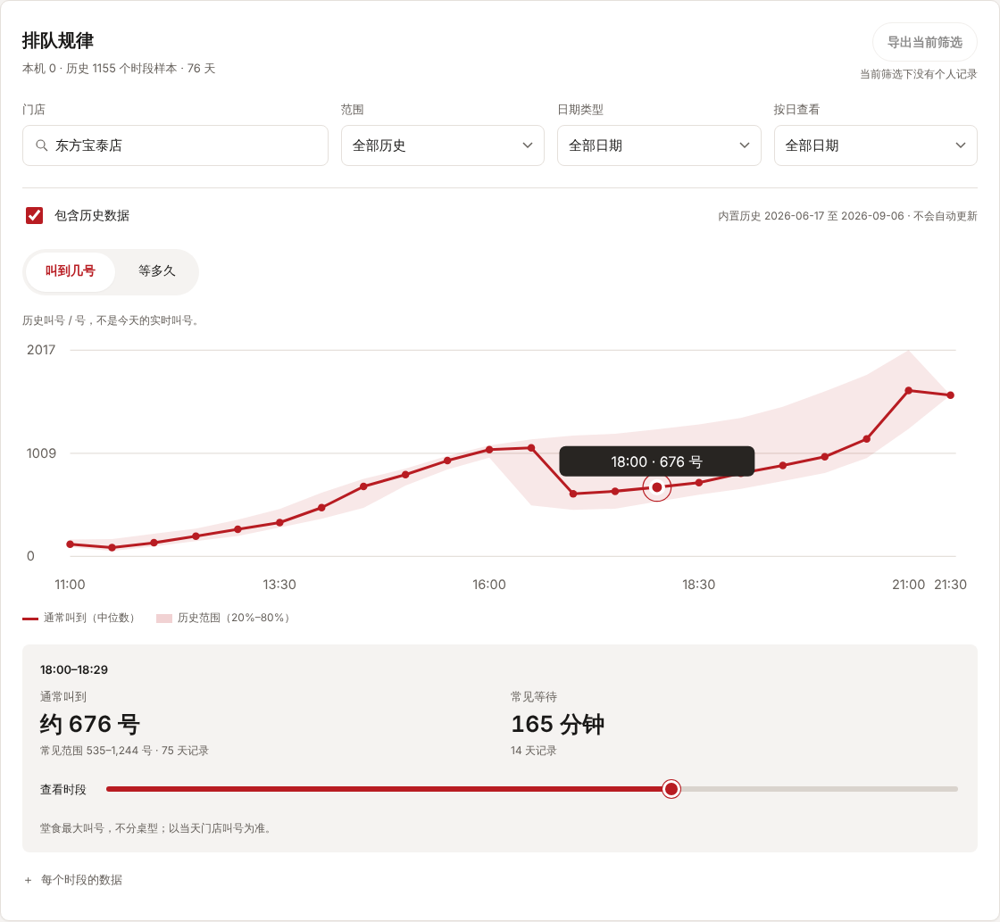
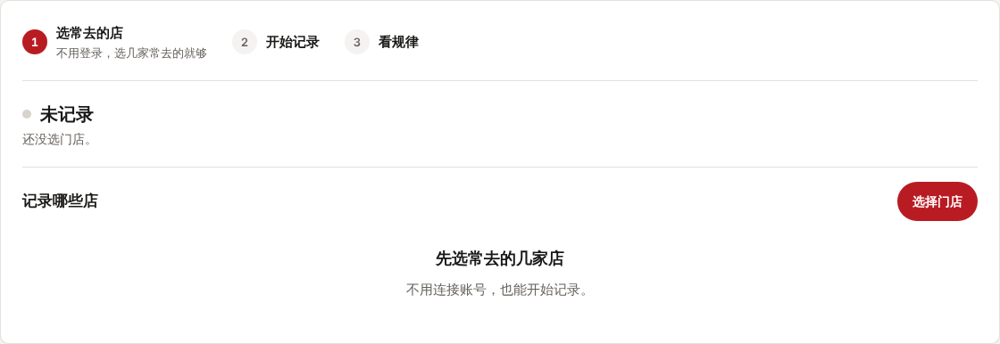

# 寿司郎排队记录

**常去的店，几点通常叫到几号？**

记下每天的排队情况，慢慢看出规律。数据留在自己电脑上。

  

[**下载最新版**](https://github.com/Ryujoxys/sushiro-overdose/releases/latest) · [使用方式](#怎么用) · [反馈问题](https://github.com/Ryujoxys/sushiro-overdose/issues)

 

点一个时段，看通常叫到几号、常见等待多久。历史规律不是今天的实时叫号。

## 下载

| Windows | macOS |
| :--- | :--- |
| **[下载 64 位 EXE](https://github.com/Ryujoxys/sushiro-overdose/releases/download/v4.0.2/Sushiro-Overdose-4.0.2-windows-amd64.exe)** | **[下载 DMG](https://github.com/Ryujoxys/sushiro-overdose/releases/download/v4.0.2/Sushiro-Overdose-4.0.2-macOS.dmg)** |
| Windows 10 / 11，下载后双击 | macOS 12+，拖入「应用程序」 |
| [ARM64 版本](https://github.com/Ryujoxys/sushiro-overdose/releases/download/v4.0.2/Sushiro-Overdose-4.0.2-windows-arm64.exe) | 同一个安装包支持 Intel / Apple 芯片 |

Linux、命令行版和文件校验值见[完整下载列表](https://github.com/Ryujoxys/sushiro-overdose/releases/latest)。不用部署网站。

## 怎么用

<table>
<tr>
<td width="50%" valign="top">

### 平时，记下排队情况

选常去的门店 → 连接实时数据 → 开着应用时自动记录，按日期看曲线。

**连接用的是你自己的小程序登录**：在「设置 → 实时数据」按引导让手机或电脑微信经过本应用，打开寿司郎小程序刷新一下；也可以粘贴抓包工具里的一条请求。约 1 小时有效，只存在这台电脑上，到期后再连一次。

</td>
<td width="50%" valign="top">

### 要去吃，算好几点取号

「想几点吃」按这家店的历史规律给出取号时间；在小程序里取号后，填上**小程序里现在叫到几号**和你的号码，应用按这家店以往的叫号速度算出大概几点叫到（回测提前 1 小时平均误差约 18 分钟）。

不连接也能用；连接后换成实时叫号。能否入座以门店实际叫号为准。

</td>
</tr>
</table>

> **2026-10 起寿司郎换了实时接口**，不再允许匿名读取叫号。现在的用法：
> - **不连接**：选门店、看历史规律、「想几点吃」、填当前叫号算几点叫到、手动记一笔，全部可用（历史数据截至 2026-09-06，会标明）。
> - **连接后**：实时叫号、自动记录、叫号提醒恢复，约 1 小时有效；独立后台记录不再无人值守运行，需要应用开着并已连接。
> [详细说明](docs/cloudflare-github-turso.md#数据库与采集2026-10-20)

**刚打开也有曲线可看。** 内置历史截至 **2026-09-06**，随应用附带，不会联网更新。取消「含内置历史」，就只看自己的记录；导出也只包含自己的数据。

<strong>安装、升级和账号连接</strong>

- Windows 缺少 WebView2 时会引导安装。macOS 若提示来源未知，请先核对下载来源，再到「隐私与安全性」允许打开。
- 升级前在「设置 → 应用与后台」退出旧版本及后台记录，再替换程序，本机记录会保留。
- 换电脑时，在设置里「备份全部记录」，到新电脑上「从备份恢复」；只补充缺少的记录，不会覆盖。
- 页面和窗口跟随系统的浅色 / 深色外观。
- 只有取号需要认证。macOS 可用电脑微信；Windows 按引导使用手机微信，安卓需导入本人抓包凭证。凭证只保存在本机。[认证与安全说明](SECURITY.md)

<strong>数据与开发文档</strong>

[数据与历史包](docs/bundled-history.md) · [开发与构建](CONTRIBUTING.md) · [代码架构](ARCHITECTURE.md) · [更新说明](docs/release-notes-4.0.2.md)

应用需要联网读取门店公开排队数据，不连接共享数据库，也不上传个人记录。

<strong>公开数据与 AI 助手技能</strong>

全国门店的历史排队数据（每店每半小时：营业状态、预估等待、在等桌数、当前叫号）每天同步到本仓库的 [`data` 分支](https://github.com/Ryujoxys/sushiro-overdose/tree/data)，不需要账号或 key，只含门店公开状态。[格式说明](docs/public-data.md)

仓库自带 Claude Code 技能 [`sushiro-queue`](.claude/skills/sushiro-queue/SKILL.md)：在仓库里问“东方宝泰周六想 7 点吃，几点取号”“我拿了 1350 号大概几点叫到”，它读这份数据算区间，本机应用开着时再看实时叫号。只读，不会替你取号。

## Star 趋势

---

Sushiro Overdose · lite正式版 · <a href="LICENSE">MIT</a> 非官方工具，与寿司郎官方无隶属关系。

